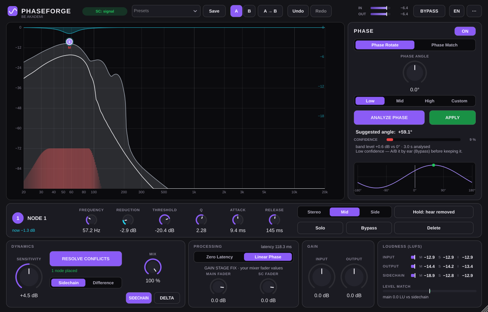

# PHASEFORGE

PHASEFORGE is a phase-alignment and frequency-conflict plugin for two sources that fight in the same range, such
as a kick and a bass, a vocal and a pad, or layered synths. It is made by BE Akademi (Berkay Er), and is free
software under the GNU AGPL v3 or later.

Formats: VST3 · AU · Standalone. Platforms: macOS 11+ (Apple Silicon and Intel), Windows and Linux builds from
source. The interface is in English by default; click **EN** in the top bar to switch to Turkish.



## What it does

| Area | What you get |
|---|---|
| **ANALYZE PHASE** | Listens to 2–5 s of the track and its sidechain playing together, then suggests the rotation angle (Phase Rotate) or a frequency-dependent correction (Phase Match) that makes the low end sum fuller. Nothing changes until you press **APPLY**. It refuses honestly when the signals are silent, unrelated or keep changing their relationship. |
| **Phase Rotate** | An all-pass rotation of one band (Low 20–200 Hz, Mid, High or Custom). 0° is a bit-exact pass-through. |
| **Phase Match** | A frequency-dependent phase correction with a Blend control. It warns when the correction is strong enough to smear transients. |
| **Conflict display** | The main signal in grey, the sidechain in white, Mid conflicts in red and Side conflicts in yellow, and the live gain reduction in cyan. |
| **RESOLVE CONFLICTS** | Listens for 3 s and places up to 8 conservative dynamic-EQ nodes on the strongest conflicts. One undo step restores your previous nodes. |
| **Dynamic EQ nodes** | 12 nodes. Each has frequency, reduction (to −18 dB), threshold, Q 0.1–20, attack 0.1–200 ms, release 5–1000 ms, Stereo/Mid/Side, solo, bypass and "hear removed" (delta). |
| **Modes** | *Sidechain*: cut when the sidechain band is loud. *Difference*: cut only by how much the main exceeds the sidechain. With Sidechain switched off the nodes are self-keyed. |
| **Filter mode** | *Linear Phase* (default; FIR, latency 118 ms at 48 kHz, which the DAW compensates) or *Zero Latency* (IIR, 0 ms). |
| **Gain Stage Fix** | Enter your two mixer fader values so conflict detection compares the levels you actually hear. |
| **Metering** | Sample peak and BS.1770-4 momentary, short-term and integrated LUFS for input, output and sidechain, plus a level-match indicator. |
| **Workflow** | Delta, Mix (dynamic EQ only), input/output gain, A/B with copy, undo/redo, factory and user presets, full automation, and a resizable window (60–200 %). |

## Quick start (Ableton Live)

1. Put PHASEFORGE on the **bass** track (the sound that should give way).
2. In the device title bar, open the sidechain section and choose the **kick** track as the source.
3. Play both. The chip at the top should read **SC: signal**.
4. Press **RESOLVE CONFLICTS**. Nodes appear where the kick and the bass collide, and each node shows its live
   reduction.
5. Press **ANALYZE PHASE**, read the confidence, and press **APPLY** if it suggests something. Toggle **BYPASS**
   to compare by ear.
6. For low-latency playing or tracking, switch the filter mode to **Zero Latency**.

Analyzer gestures:
- Double-click to add a node.
- Drag a node to move it (x = frequency, y = reduction); hold Shift for fine control.
- Use the mouse wheel over a node to change its Q.
- Drag on empty space to select several nodes.
- Right-click a node for solo, bypass, Mid/Side or delete.
- Press Delete to remove the selected nodes.
- Use the mouse wheel on empty space to zoom, and press R to reset the zoom.

## Install

- **Mac** (local, unsigned build; nothing is published). Paste into Terminal:
  ```bash
  [ -d ~/be-akademi ] || git clone -b claude/nice-goodall-ygxn6x https://github.com/erberkay/berkayeracademy.git ~/be-akademi; cd ~/be-akademi && git pull && bash tools/phaseforge/scripts/mac-kur.sh
  ```
  The script installs JUCE 9.0.6, builds AU and VST3 for this Mac, runs the plugin tests, installs to
  `~/Library/Audio/Plug-Ins`, signs ad-hoc and runs `auval`. Then rescan the plug-ins in your DAW.
- **Build by hand** (any OS): CMake ≥ 3.22, a C++20 compiler, and JUCE 9.0.6 in `~/kbdeps/juce`:
  ```bash
  cmake -S tools/phaseforge -B build -G Ninja -DCMAKE_BUILD_TYPE=Release -DPF_DEPS_DIR=$HOME/kbdeps
  ninja -C build PHASEFORGE_VST3 PHASEFORGE_AU   # AU only on macOS
  ```
- **Presets.** The factory presets are built in. `Presets/` contains the same ones as `.pfpreset` files, as
  examples of the format. Your own presets are saved to `~/Library/Application Support/BE Akademi/PHASEFORGE/Presets`
  on macOS and `%APPDATA%\BE Akademi\PHASEFORGE\Presets` on Windows.

## Documentation

- `RESEARCH/FUSER_TECHNICAL_ANALYSIS.md` — a study of a commercial plugin's *documented* behaviour (manual,
  product pages, reviews, cited), and how PHASEFORGE addresses each point.
- `RESEARCH/DSP_DESIGN.md` — every algorithm, with the reason for each design decision.
- `docs/ARCHITECTURE.md` — signal flow, threads, real-time rules and latency.
- `TEST_REPORT.md` — what was tested and how, the results, and what was *not* tested.

## Independence

PHASEFORGE is an independent implementation. No code, artwork, presets or trademarks from any other product were
used. Where a public manual described a behaviour, we wrote our own algorithm for it, and the docs say so.

## License

- PHASEFORGE: GNU AGPL v3 or later (`LICENSE`).
- Inter typeface: SIL Open Font License 1.1 (`Resources/fonts/`).
- JUCE: used under its AGPLv3 option.
